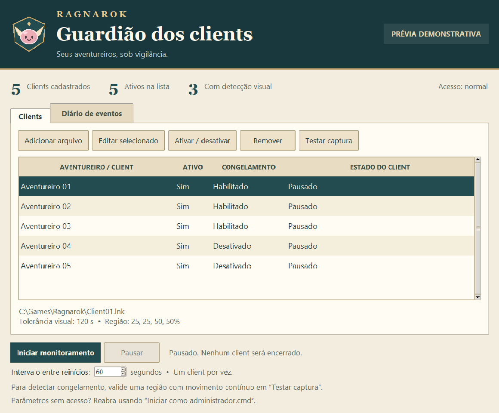

# Ragnarok Client Monitor

**Guardião dos clients** é um aplicativo local para Windows que monitora múltiplos clients e reabre seus atalhos quando fecham, congelam ou apresentam a janela **Gravity Error Handler**.

A interface é inspirada no Ragnarok, com tons de pergaminho, detalhes dourados e um emblema desenhado localmente. O projeto não é afiliado à Gravity e não inclui arquivos do jogo.



## O que faz

- Permite adicionar, editar, remover e ativar ou desativar atalhos, sem uma quantidade fixa de clients.
- Identifica cada processo pelo executável e pela lista completa de argumentos do atalho.
- Reabre processos fechados e reconhece a janela de erro do Ragnarok pertencente ao processo identificado.
- Detecta imagem congelada em uma região configurável, depois de observar movimento.
- Reinicia **um client por vez**, com intervalo configurável de **60 segundos** por padrão.
- Exibe estados individuais, configuração selecionada e diário de eventos.
- Limita tentativas consecutivas e impede que duas instâncias do monitor atuem juntas na mesma sessão do Windows.

## Começar

Requer **Windows**, **Python 3 com tkinter** e **Windows PowerShell 5.1** (`powershell.exe`). A versão de desenvolvimento foi testada com Python 3.11. Não há dependências Python externas em tempo de execução.

1. Baixe o código em **Code → Download ZIP**, ou clone o repositório.
2. Extraia para uma pasta em que você tenha permissão de escrita. O programa salva a configuração e o histórico nessa pasta.
3. Abra **Iniciar.cmd**. Se o jogo roda como administrador, abra **Iniciar como administrador.cmd** e confirme a solicitação do Windows.
4. Use **Adicionar arquivo** para cadastrar seus atalhos `.lnk` ou executáveis `.exe`.
5. Selecione cada client e teste sua captura antes de habilitar a detecção de congelamento.
6. Ajuste **Intervalo entre reinícios** e clique em **Iniciar monitoramento**.

A primeira execução cria um `config.json` **vazio**. Não é necessário copiar nem editar o arquivo de exemplo. O aplicativo começa pausado. Fechá-lo interrompe o monitoramento; ele não instala serviço nem tarefa agendada.

Para iniciar pelo terminal:

```powershell
python monitor.py
```

## Reinício em sequência

Quando vários clients precisam de reinício, o monitor tenta abrir um e mantém os demais na fila. A espera mínima começa depois de abrir o atalho; durante a espera, as verificações continuam. As pendências são reavaliadas antes de qualquer ação.

O padrão de **60 segundos** é uma espera fixa, não uma confirmação de que o jogo terminou de carregar. Se o próximo client abrir antes de o anterior estar pronto, aumente para **90 segundos** ou mais. O intervalo pode variar entre 15 e 3600 segundos.

Os processos fechados aguardam inicialmente até 90 segundos antes de serem reabertos. Um processo novo também recebe 90 segundos de tolerância para carregamento antes da detecção visual. A janela Gravity Error Handler persistente pode ser recuperada antes dessa tolerância, após 10 segundos de confirmação.

## Validar a detecção de congelamento

**Imagem parada nem sempre significa jogo travado.** Pause o monitor, selecione um client e use **Testar captura**. Repita após alguns segundos para confirmar que a imagem está atualizada, inclusive com janelas parcialmente sobrepostas.

Em **Editar selecionado**, escolha uma região com movimento contínuo, mesmo com o personagem parado. Só então habilite **Detectar congelamento**. A região usa porcentagens; `25, 25, 50, 50` representa o retângulo central.

Captura preta, janela minimizada ou falha de captura suspende a detecção visual. Uma captura antiga fornecida pelo jogo pode causar um falso positivo; por isso a validação é necessária. Mesmo com detecção visual desativada, o monitor recupera processos fechados e janelas de erro reconhecidas.

## Documentação

- [Configuração e uso](docs/CONFIGURACAO.md)
- [Solução de problemas](docs/SOLUCAO-DE-PROBLEMAS.md)
- [Funcionamento e limites](docs/ARQUITETURA.md)
- [Como contribuir e executar testes](CONTRIBUTING.md)
- [Histórico de alterações](CHANGELOG.md)

## Dados locais e atualização

`config.json`, `monitor.log`, atalhos reais e dumps do jogo são dados locais e estão excluídos do Git. O repositório contém somente um exemplo fictício. Não publique parâmetros de login, senhas ou conteúdo de dumps em issues.

Para atualizar uma instalação existente, feche o monitor, preserve `config.json` e substitua os arquivos do aplicativo. Os clients podem continuar abertos. Reabra o monitor e inicie as verificações novamente.

## Limites

O monitor não executa login dentro do jogo nem seleciona personagens; ele reabre o arquivo cadastrado. Os atalhos precisam apontar diretamente para um executável existente. Launchers que criam outro processo com parâmetros diferentes podem exigir adaptação.

A captura usa `PrintWindow` e pode não funcionar com alguns clients ou modos gráficos. O programa não lê memória do jogo nem injeta código. Recuperar uma janela de erro não corrige a causa interna da falha do Ragnarok.

Não há um `.exe` independente nem licença de distribuição definida nesta versão.
